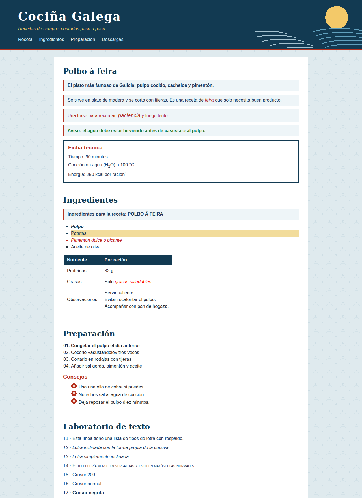
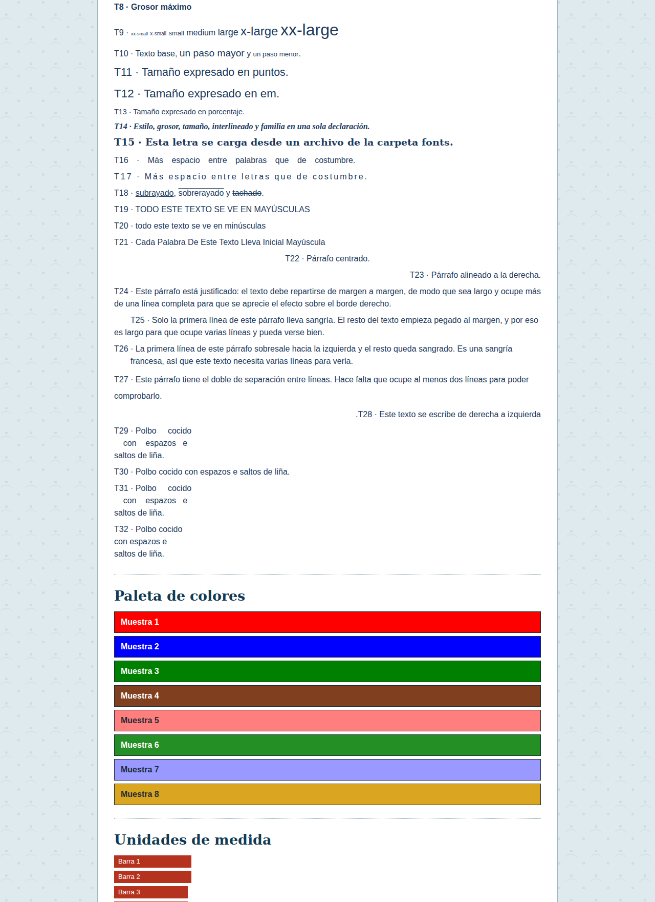
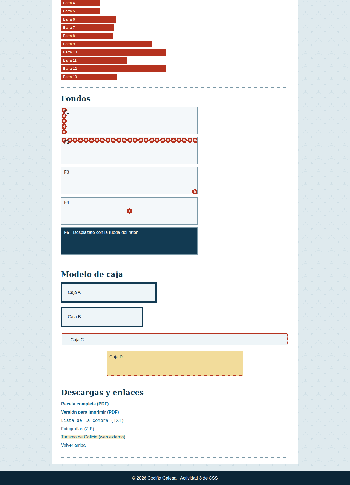
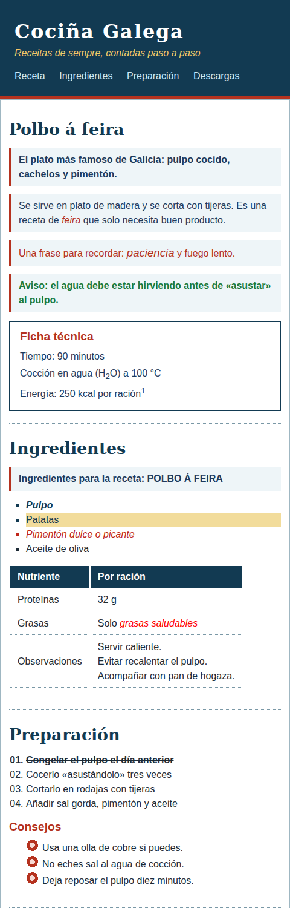

# Actividad 3 · Aplicando estilo con CSS

**UD1 · Aplicaciones web y lenguajes de marcas: HTML y CSS**

Tienes una página web (`index.html`) con todo su contenido y su estructura, pero **sin ningún estilo**. Tu misión es lograr que se vea **exactamente como en las capturas de este documento**, escribiendo únicamente CSS.

> El enunciado te dice **qué** debe verse, no **cómo** conseguirlo. Elegir la técnica correcta forma parte de la actividad.

---

## 1. Material entregado

```
actividad3-css/
├── index.html          ← NO se modifica (salvo lo indicado en el apartado 3)
├── README.md           ← este documento
├── css/
│   ├── estilo.css      ← hoja externa principal (esqueleto con secciones)
│   └── paleta.css      ← hoja externa secundaria (vacía)
├── img/                ← fondo.png, vineta.png, cabecera.png y capturas
└── fonts/
    └── DejaVuSerif-Bold.ttf   ← tipografía libre (licencia DejaVu)
```

## 2. Resultado que debes conseguir

Capturas con una ventana de **1280 px de ancho**.







Con una ventana **estrecha** (menos de 700 px) debe verse así (primera parte):



Lo que **no** se aprecia en una captura estática y también debes conseguir: el comportamiento de los enlaces al pasar el ratón o hacer clic (apartado 4.N) y el fondo fijo de **F5** (al hacer scroll, el dibujo de fondo no se mueve con la página).

---

## 3. Reglas del juego

1. No puedes cambiar el contenido ni las etiquetas de `index.html`. **Solo** puedes escribir:
   - dentro de la etiqueta `<style>` de la cabecera (lo que pida el apartado 4.A),
   - y **un único** atributo en **una única** etiqueta (apartado 4.A).
2. Tu CSS debe estar **comentado** y organizado en las secciones que trae `estilo.css`.
3. Las reglas que aparecen al final de `estilo.css` bajo *«REGLAS YA EXISTENTES»* **no se pueden borrar ni modificar**.
4. Todos los colores, tamaños y valores que figuran en las tablas son los que debes usar.
5. Usa las herramientas de desarrollo del navegador (**F12**) para comparar y medir.

---

## 4. Cambios a realizar

### A. Dónde se escribe el CSS

| Dónde | Qué debe contener |
|---|---|
| Hoja **externa** `css/estilo.css` | Todo el diseño. Debe declarar su codificación de caracteres como UTF-8 en su primera línea. |
| Hoja **interna** (`<style>` del `index.html`) | **Solo** una cosa: el lema de la cabecera («Receitas de sempre…») debe verse en dorado `#F3C969`. La hoja externa ya lo deja en blanco y **no debes tocar esa regla**. |
| En la **propia etiqueta** | **Solo** el pie de página: color de fondo `#0B2536`. La hoja externa ya le da un fondo gris. |
| `css/paleta.css` | Los colores de las **Muestras 1 a 8** (apartado J). Este archivo debe cargarse **desde `estilo.css`**, sin añadir ningún `<link>` nuevo al HTML. |

### B. Reglas generales de la página

| Elemento | Resultado |
|---|---|
| **Todos** los elementos | Sin márgenes ni rellenos por defecto del navegador. El ancho o alto que indiques para una caja es el de la caja **completa** (relleno y borde incluidos). Única excepción: la **Caja A** (apartado M). |
| Texto de la página | 16 px, interlineado 1,5. Tipografía: *Trebuchet MS*; si no está, *Verdana*; si tampoco, una letra sin remates del sistema. Color `#1D2B36`. |
| Fondo de la página | Color `#DFEAEE` y, encima, la imagen `img/fondo.png` repetida por toda la página. |
| Párrafos | 12 px de separación por debajo. |
| Listas (con y sin numeración) | 28 px de sangría por la izquierda y 12 px de separación por debajo. |
| Aviso («Aviso: el agua debe estar hirviendo…») | Hoy se ve en naranja por una regla existente. Debe verse en **verde `#1B7A3A` y negrita**, sin borrar ni editar esa regla. |
| Títulos `h2` y `h1` | Tipografía descargada llamada **Pulpeira** (archivo de la carpeta `fonts`), con una letra con remates como alternativa. |

### C. Cabecera y menú

| Elemento | Resultado |
|---|---|
| Cabecera | Fondo `#123A52` con la imagen `img/cabecera.png` **una sola vez**, pegada a la derecha y centrada en vertical. Relleno: 28 px arriba, 5 % a los lados, 20 px abajo. Borde inferior de 6 px, continuo, `#B5321F`. |
| Título `Cociña Galega` | Tamaño 2,6 veces el tamaño base de la página (no del elemento padre), blanco, con 2 px de separación entre letras. |
| Lema | Cursiva (y color según el apartado A). |
| Menú de enlaces | Separación amplia entre enlaces (1,2 veces el tamaño de letra). Enlaces en azul claro `#CFE9F5` **sin subrayar**; al pasar el ratón `#F3C969`; al pulsar, blanco. |

### D. Contenedor, secciones y títulos

| Elemento | Resultado |
|---|---|
| Contenedor central | Ocupa **tres cuartas partes** de la ventana, sin pasar de 900 px ni bajar de 300 px. Centrado horizontalmente, 24 px de separación arriba y abajo. Relleno: 8 px arriba, 32 px a los lados, 24 px abajo. Fondo blanco y borde de 1 px continuo `#9FB7C2`. |
| Cada sección | 20 px de relleno arriba y abajo. Línea inferior de puntos de 1 px `#7A98A6`. |
| `h2` | 1,7 veces el tamaño base de la página, color `#123A52`, 10 px de separación inferior. |
| `h3` | 1,2 veces el tamaño de su elemento padre, color `#B5321F`, 6 px de separación inferior. |

### E. Receta: contenedores, herencia y prioridad

| Qué debe verse | Resultado |
|---|---|
| **Todos** los párrafos de las secciones (también los que están dentro de otras cajas) | Texto azul oscuro `#1D3A5C`. |
| Solo los párrafos que cuelgan **directamente** de una sección (no los de la «Ficha técnica» ni los del laboratorio) | Fondo `#EEF5F8` y 8 px de relleno arriba/abajo y 12 px a los lados. |
| El párrafo que va **justo después** de cada título `h2` | Texto algo más grueso (600). |
| **Todos** los párrafos que son hermanos de un título `h2` y le siguen | Línea de 4 px continua `#B5321F` en el lado izquierdo. |
| «feira» (dentro del segundo párrafo) | Rojo `#B5321F` e inclinado sin cambiar la forma de las letras. |
| Párrafo de la cita («Una frase para recordar…») | Rojo `#B5321F` y 12 pt. La palabra *paciencia* debe verse a 14 pt, **pero sin escribir su color**: debe heredarlo. |
| «Ficha técnica» | Borde de 2 px continuo `#123A52`, 10 px de relleno arriba/abajo y 16 px a los lados, 14 px de separación superior. Sus párrafos solo llevan 4 px de separación inferior. |

### F. Ingredientes

Piensa en **qué tienen en común** los elementos de cada fila.

| Qué elementos | Resultado |
|---|---|
| Los ingredientes que indican una cantidad | Texto azul marino `#123A52`. |
| Los ingredientes de tipo *vegetal* | Fondo `#F2DC9B`. |
| Los ingredientes cuya cantidad se expresa como «al gusto» (reconócelos por una parte de su valor) | Texto rojo `#C0261A`. |
| El fragmento de texto marcado como idioma gallego | Todo en mayúsculas. |
| Los ingredientes cuya cantidad **termina** en `kg` | Negrita. |
| Los ingredientes con la etiqueta *tradicional* (entre varias etiquetas) | Cursiva. |
| La lista de ingredientes | Viñetas cuadradas. |

### G. Tabla de nutrición

| Elemento | Resultado |
|---|---|
| Tabla | 14 px de separación arriba y abajo. |
| Celdas de cabecera | Alineadas a la izquierda, texto blanco, fondo `#123A52`, relleno 6 px × 12 px. |
| Celdas de datos | Relleno 6 px × 12 px y línea inferior de 1 px de puntos `#7A98A6`. |
| «Observaciones» | Su texto debe quedar **centrado en vertical** dentro de la celda. |
| «grasas saludables» | Texto **rojo puro**. Esta regla debe afectar a cualquier texto enfatizado que esté **en cualquier punto dentro de una tabla**, no solo a este. |

### H. Preparación y listas

| Elemento | Resultado |
|---|---|
| Lista de pasos | Numeración `01, 02, 03, 04…`. |
| Paso con la clase `primero` | Negrita. |
| Pasos con la clase `hecho` | Tachados. El primer paso debe verse **a la vez** en negrita y tachado. |
| Lista de consejos | Viñeta personalizada con `img/vineta.png`, **dentro** de la caja del texto, y círculo relleno como alternativa si la imagen falla. Todo en **una sola declaración**. |

### I. Laboratorio de texto (T1 – T32)

| Código | Resultado esperado |
|---|---|
| T1 | Tahoma → Corbel → una letra sin remates del sistema. |
| T2 | Cursiva con la forma propia de la letra. |
| T3 | Letra simplemente inclinada (oblicua). |
| T4 | Versalitas. |
| T5 – T8 | Grosores 200, 400, 700 y 900, por este orden. |
| T9 | Cada palabra con el tamaño que dice su nombre, de `xx-small` a `xx-large`. |
| T10 | «un paso mayor» y «un paso menor» respecto al tamaño del texto que los rodea. |
| T11 | 16 puntos. |
| T12 | 1,4 veces el tamaño del elemento padre. |
| T13 | 90 %. |
| T14 | Cursiva, negrita, 12 pt, interlineado de 14 pt, letra con remates. **Una sola declaración.** |
| T15 | Con la tipografía Pulpeira, a 1,2 veces el tamaño. |
| T16 | 12 px extra entre palabras. |
| T17 | 3 px extra entre letras. |
| T18 | «subrayado» subrayado, «sobrerayado» con línea por encima, «tachado» tachado. |
| T19 | El texto se ve en mayúsculas (aunque está escrito en minúsculas). |
| T20 | El texto se ve en minúsculas (aunque está escrito en mayúsculas). |
| T21 | Cada palabra con inicial mayúscula. |
| T22, T23, T24 | Centrado, alineado a la derecha y justificado. |
| T25 | Primera línea con sangría de 2 veces el tamaño de la letra. |
| T26 | Sangría francesa de 2 veces el tamaño de la letra. |
| T27 | Interlineado doble (el doble del tamaño de la letra). |
| T28 | Escritura de derecha a izquierda. |
| T29 | Respeta espacios y saltos de línea, y **no** ajusta el texto al ancho. |
| T30 | Todo en una sola línea: espacios reducidos a uno y sin saltos. |
| T31 | Respeta espacios y saltos de línea, y **sí** ajusta el texto al ancho. |
| T32 | Reduce los espacios a uno, respeta los saltos de línea y ajusta el texto al ancho. |

Cada párrafo del laboratorio debe llevar además **8 px de separación inferior**.

### J. Paleta de colores

Fondo de cada muestra: el color indicado, **escrito con la notación que se pide**. Texto blanco y negrita, borde de 1 px continuo `#1D2B36`, relleno 8 px × 12 px y 6 px de separación inferior. En las muestras 5, 7 y 8 el texto debe ser oscuro `#1D2B36` para que se lea.

| Muestra | Color | Notación obligatoria |
|---|---|---|
| 1 | Rojo puro | Hexadecimal **abreviado** |
| 2 | Azul puro | Hexadecimal de seis cifras |
| 3 | Verde oscuro (0, 128, 0) | Función RGB |
| 4 | Marrón rojizo: 50 % rojo, 25 % verde, 12 % azul | RGB con porcentajes |
| 5 | Rojo puro con la mitad de opacidad | RGB con transparencia |
| 6 | Verde: tono 120, saturación 60 %, luminosidad 35 % | HSL |
| 7 | Azul puro: tono 240, 100 %, 50 %, con 40 % de opacidad | HSLA |
| 8 | Dorado oscuro | Por su nombre estándar (`goldenrod`) |

### K. Unidades de medida

Cada barra mide 24 px de alto, tiene 8 px de relleno a la izquierda, 6 px de separación inferior, texto blanco de 13 px y fondo `#B5321F`. **Solo cambia su longitud:**

| Barra | Longitud |
|---|---|
| 1 | 4 centímetros |
| 2 | 40 milímetros (**misma** longitud que la barra 1) |
| 3 | 1,5 pulgadas |
| 4 | 108 puntos (**misma** longitud que la barra 3) |
| 5 | 9 picas (**misma** longitud que la barra 3) |
| 6 | 200 píxeles |
| 7 | 15 veces el tamaño de letra de la propia barra |
| 8 | 12 veces el tamaño de letra del elemento raíz |
| 9 | 40 % del ancho de su contenedor |
| 10 | 30 % del ancho de la ventana |
| 11 | 30 % de la menor dimensión de la ventana |
| 12 | 30 % de la mayor dimensión de la ventana |
| 13 | 30 veces la altura de la «x» minúscula |

Comprueba en el navegador (redimensionando la ventana) qué barras cambian y cuáles no.

### L. Fondos

Las cinco cajas miden 60 % de ancho y 100 px de alto, con 10 px de separación inferior, borde de 1 px continuo `#7A98A6`, relleno 6 px × 10 px y color de base `#F4F8FA`. Todas usan `img/vineta.png`:

| Caja | Resultado |
|---|---|
| F1 | La imagen se repite **solo en vertical**. |
| F2 | La imagen se repite **solo en horizontal**. |
| F3 | Una sola imagen, en la esquina inferior derecha. |
| F4 | Una sola imagen, justo en el centro. |
| F5 | Fondo `#123A52` con la imagen repetida, texto blanco, y la imagen **queda fija** aunque se desplace la página. |

### M. Modelo de caja

| Caja | Resultado |
|---|---|
| **A** y **B** | Ancho de 300 px, relleno de 20 px, borde de 5 px continuo `#123A52`, fondo `#EEF5F8`, 16 px de separación inferior. **En A, el relleno y el borde se suman por fuera de los 300 px (la caja ocupará 350 px en pantalla). En B, la caja entera ocupa 300 px.** Comprúebalo con F12. |
| **C** | Relleno: 10 px arriba, 20 px a la derecha, 5 px abajo, 30 px a la izquierda. Márgenes: 20 px arriba y abajo, 5 px a los lados. Bordes: arriba **grueso**, derecha **fino**, abajo **mediano**, izquierda **sin borde**. Estilos: arriba y abajo continuo, derecha e izquierda discontinuo. Color de borde `#B5321F`. Fondo `#EEF5F8`. |
| **D** | Ocupa el 75 % de su contenedor, **sin pasar de 500 px ni bajar de 300 px**, y como mínimo 90 px de alto aunque tenga poco texto. **Centrada** horizontalmente. Relleno 10 px, fondo `#F2DC9B`, y solo un borde inferior de 1 px de puntos `#B5321F`. |

### N. Enlaces y descargas

| Elemento | Resultado |
|---|---|
| Enlace normal (no visitado) | Azul `#0B5F8A`, subrayado. |
| Enlace ya visitado | Morado `#6B4A8A`. |
| Con el puntero encima | Rojo `#B5321F` y sin subrayado. |
| En el instante del clic | Dorado `#D9A441`. |
| Lista de descargas | Sin viñetas, sin sangría, 6 px de separación entre elementos. |
| Enlaces a archivos **PDF** (¡también el que lo lleva en mayúsculas!) | Negrita. |
| Enlaces a archivos **TXT** | Letra monoespaciada. |
| Enlaces que apuntan a una web externa (dirección que empieza por `https`) | Fondo `#FBF1CF`. |

> Cuidado: los cuatro estados de los enlaces deben seguir funcionando aunque apliques las reglas de PDF, TXT y externos.

### O. Pie de página

El texto del pie va centrado, sin margen inferior en su párrafo. Recuerda el apartado A: el color de fondo final lo decide el atributo en la propia etiqueta.

### P. Pantallas pequeñas

Cuando la ventana mida **700 px de ancho o menos**:

- Ni la página ni la cabecera muestran imagen de fondo (la página queda en el color plano de base).
- El título principal baja a 2 veces el tamaño base de la página.
- El contenedor ocupa **todo el ancho** de la ventana, sin márgenes, con relleno de 8 px arriba, 14 px a los lados y 24 px abajo.
- Las cajas de fondo F1–F5 ocupan el 100 % del ancho.

---

## 5. Preguntas de reflexión

Contesta en un archivo `respuestas.txt` (2–3 líneas cada una):

1. En la cabecera, el lema tiene un color en la hoja externa y otro en la interna. ¿Cuál se ve y por qué? ¿Y si cambiaras el orden en que están escritas en el HTML?
2. El pie tiene un fondo en la hoja externa y otro en su propia etiqueta. ¿Cuál gana? ¿Qué lugar de la cascada pesa más?
3. ¿Por qué el aviso seguía naranja aunque tú escribieras verde? ¿Qué has hecho para evitarlo? ¿Es una buena práctica usarlo con frecuencia?
4. ¿Por qué la palabra *paciencia* hereda el color pero no el tamaño que le diste?
5. En las barras, ¿qué diferencia observas entre las unidades **absolutas** y las **relativas** al redimensionar la ventana?
6. La Caja A y la Caja B tienen el mismo ancho declarado. ¿Por qué se ven distintas?

---

## 6. Evaluación (100 puntos)

| Criterio | Puntos |
|---|---|
| Selectores: universal, clase, id, combinaciones, atributos (B, E, F, G, H) | 30 |
| Colores, unidades y fondos (J, K, L) | 25 |
| Modelo de caja (D, M) | 15 |
| Listas y enlaces (H, N) | 15 |
| Orden, comentarios y limpieza del CSS | 10 |
| Respuestas a las preguntas de reflexión | 5 |

## 7. Entrega

Comprime la carpeta `actividad3-css` en un `.zip` con tu nombre (`Apellido_Nombre_UD1_A3.zip`) y súbelo a la plataforma.
